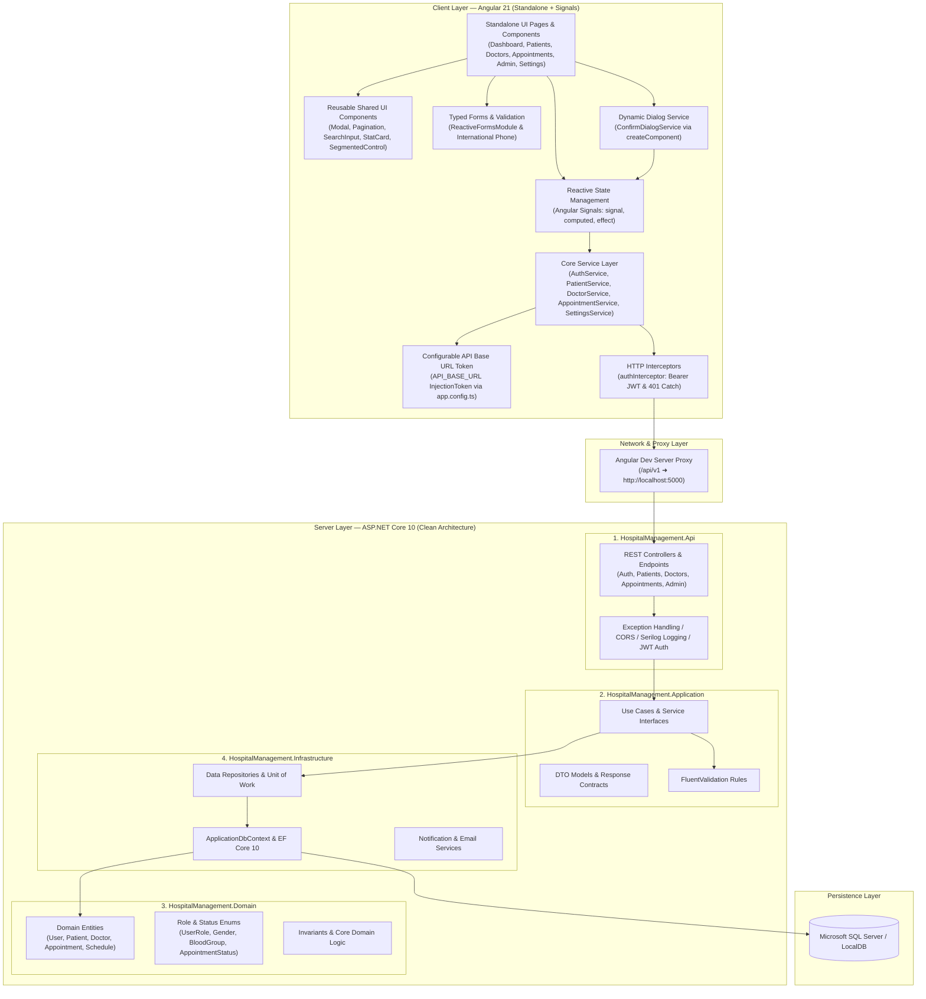

# 🏥 CareFlow Hospital Management System (HMS)

> A modern, enterprise-grade **Hospital Management System** built with **Angular 21** (Standalone Components, Signals, Modern Control Flow, Tailwind CSS v4) and **ASP.NET Core 10** (.NET 10, Entity Framework Core, SQL Server) adhering to **Clean Architecture** and **Feature-Based Frontend Design**.

[](https://angular.dev/)
[](https://dotnet.microsoft.com/)
[](https://www.typescriptlang.org/)
[](https://tailwindcss.com/)
[](https://www.microsoft.com/sql-server/)

---

## 📚 Table of Contents
1. [Architectural Overview](#-architectural-overview)
2. [Junior Developer Guide & Mental Model](#-junior-developer-guide--mental-model)
3. [Reusable Shared UI Components](#-reusable-shared-ui-components)
4. [Centralized API Base URL Configuration](#-centralized-api-base-url-configuration)
5. [Key Modules & Capabilities](#-key-modules--capabilities)
6. [Repository Structure](#-repository-structure)
7. [Getting Started & Local Setup](#-getting-started--local-setup)
8. [Performance & Coding Standards](#-performance--coding-standards)
9. [Available Scripts & Quality Suite](#-available-scripts--quality-suite)

---

## 🏛️ Architectural Overview

CareFlow HMS is structured strictly following **Clean Architecture** and **Domain-Driven Design (DDD)** principles:



---

## 🎓 Junior Developer Guide & Mental Model

Welcome to the CareFlow HMS engineering team! Below is the core mental model you need to understand to write clean, bug-free, performant code in this repository.

### 1. State Management: Signals vs. RxJS Observables
In Angular 21, we use **Angular Signals** for local UI state and **RxJS Observables** for asynchronous data streams (such as HTTP requests):

| Mechanism | When to Use | Example in Code |
| :--- | :--- | :--- |
| **`signal(initialValue)`** | Reactive synchronous UI state (e.g. `isLoading`, `selectedDate`, `activeTab`, `isModalOpen`). | `readonly isBookingModalOpen = signal(false);` |
| **`computed(() => ...)`** | Derived synchronous values that automatically recompute when dependent signals update. | `readonly confirmedCount = computed(() => this.allAppointments().filter(a => a.status === 'Confirmed').length);` |
| **`Observable<T>`** | Async HTTP calls, event streams, or router notifications. | `doctorService.getDoctors(): Observable<DoctorDto[]>` |
| **`takeUntilDestroyed()`** | Pipe onto long-lived observables (`router.events`, `route.queryParams`) to auto-unsubscribe and prevent memory leaks. | `this.route.queryParams.pipe(takeUntilDestroyed(this.destroyRef)).subscribe(...)` |

### 2. Can We Use `new MyComponent()` in Angular?
**NO.** Never instantiate an Angular component using the JavaScript `new` operator (e.g., `new BookingModalComponent()`).
- **Why?** `new` only runs the TypeScript constructor. It **does NOT** trigger Angular Dependency Injection, does **NOT** compile or render HTML/CSS templates, does **NOT** attach to Angular Change Detection, and does **NOT** run lifecycle hooks (`ngOnInit`, `ngOnChanges`).
- **What to do instead:**
  1. **Declarative Component (Preferred)**: Put `<app-modal>` or `<app-pagination>` directly in your HTML template and bind properties with `[isOpen]="isModalOpen()"`.
  2. **Imperative Dynamic Dialog**: Inject [`ConfirmDialogService`](file:///d:/Projects/HospitalManagementSystem_Angular/frontend/src/app/shared/services/confirm-dialog.service.ts), which internally uses `createComponent(ConfirmDialogComponent, { environmentInjector })` to dynamically instantiate, attach, and destroy components properly.

### 3. Step-by-Step Guide: Adding a New Feature
Follow this 5-step checklist whenever creating a new page or capability (e.g. `Prescriptions`):

1. **Step 1: Define TypeScript Models (`src/app/core/models/prescription.models.ts`)**
   - Create strong interfaces/DTOs for requests and responses matching backend API contracts.
2. **Step 2: Create Core Service (`src/app/core/services/prescription.service.ts`)**
   - Inject `HttpClient` and `API_BASE_URL`.
   - Use `shareReplay({ bufferSize: 1, refCount: false })` if the endpoint returns static/reference data.
3. **Step 3: Create Feature Page Component (`src/app/features/prescriptions/pages/...`)**
   - Declare as `standalone: true`.
   - Set `changeDetection: ChangeDetectionStrategy.OnPush` where applicable.
   - Use shared components: `<app-page-header>`, `<app-pagination>`, `<app-search-input>`, `<app-modal>`, `<app-status-badge>`.
4. **Step 4: Register Route in `src/app/app.routes.ts`**
   - Use lazy loading: `loadComponent: () => import('./features/prescriptions/...').then(m => m.PrescriptionsPageComponent)`.
   - Attach guards if protected: `canActivate: [authGuard, roleGuard]`, `data: { roles: STAFF_ROLES }`.
5. **Step 5: Run Code Quality Suite**
   - Run `npm run lint` and `npm run build` in `frontend/` to verify zero errors before committing.

---

## 🧩 Reusable Shared UI Components

To maintain visual consistency and eliminate duplicate code across pages, CareFlow provides standardized components in `src/app/shared/components/`:

### 1. Common Modal (`<app-modal>`)
Replaces manual backdrop overlays, blur styles, and escape-key handling:
```html
<app-modal
  [isOpen]="isModalOpen()"
  title="Edit Patient Details"
  subtitle="Update demographic records and emergency contact info."
  icon="user"
  size="xl"
  (close)="isModalOpen.set(false)"
>
  <!-- Main modal body content here -->
  <form (ngSubmit)="save()">
    ...
  </form>

  <!-- Optional Footer Slot -->
  <div footer>
    <button type="button" (click)="isModalOpen.set(false)" class="cf-btn-cancel">Cancel</button>
    <button type="submit" class="cf-btn-primary">Save Changes</button>
  </div>
</app-modal>
```

### 2. Table Pagination (`<app-pagination>`)
Standardizes page navigation, boundary clamping, and disabled states across data tables:
```html
<app-pagination
  [currentPage]="currentPage()"
  [totalPages]="totalPages()"
  [totalItems]="filteredPatients().length"
  itemName="patients"
  (pageChange)="currentPage.set($event)"
></app-pagination>
```

### 3. Search Input (`<app-search-input>`)
Search bar with debounced input, search icon, and automatic clear `(X)` button. Compatible with `[(ngModel)]` or two-way binding:
```html
<app-search-input
  placeholder="Search by name, MRN, phone..."
  [(ngModel)]="searchQuery"
  (search)="onSearchChange($event)"
></app-search-input>
```

### 4. Dynamic Confirmation Service (`ConfirmDialogService`)
Open confirmation dialogs directly from TypeScript code without cluttering HTML templates:
```typescript
import { ConfirmDialogService } from '@shared/services/confirm-dialog.service';

export class AppointmentListPageComponent {
  private confirmDialog = inject(ConfirmDialogService);

  async cancelAppointment(appointmentId: number) {
    const confirmed = await this.confirmDialog.confirm({
      title: 'Cancel Appointment',
      message: 'Are you sure you want to cancel this appointment? This action cannot be undone.',
      confirmText: 'Yes, Cancel',
      variant: 'danger' // 'danger' | 'warning' | 'primary' | 'info'
    });

    if (confirmed) {
      this.appointmentService.updateAppointmentStatus(appointmentId, AppointmentStatus.Cancelled).subscribe();
    }
  }
}
```

### 5. Stat Metric Card (`<app-stat-card>`)
Displays KPI metric blocks with titles, numbers, icons, and OnPush change detection:
```html
<app-stat-card
  title="Total Visits"
  [value]="totalAppointments()"
  icon="calendar"
  iconColorClass="bg-blue-50 text-blue-600 dark:bg-blue-950/60 dark:text-blue-400"
></app-stat-card>
```

### 6. Segmented Control / Tabs (`<app-segmented-control>`)
Accessible pill switchers with ARIA tablist roles and badge support:
```html
<app-segmented-control
  [options]="[
    { label: 'Table View', value: 'table', icon: 'activity' },
    { label: 'Calendar View', value: 'calendar', icon: 'calendar' }
  ]"
  [selected]="viewMode()"
  (selectionChange)="viewMode.set($event)"
></app-segmented-control>
```

---

## 🌐 Centralized API Base URL Configuration

The frontend provides a **single, centralized configuration point** for backend API communication:

```
┌─────────────────────────────────┐
│ src/environments/environment.ts │ ➜ apiBaseUrl: '/api/v1'
└────────────────┬────────────────┘
                 │
                 ▼
┌─────────────────────────────────┐
│     src/app/app.config.ts       │ ➜ provide: API_BASE_URL, useValue: environment.apiBaseUrl
└────────────────┬────────────────┘
                 │
                 ▼
┌─────────────────────────────────┐
│     Core Angular Services       │ ➜ private readonly baseUrl = inject(API_BASE_URL);
│  (Auth, Patient, Doctor, Appt)  │    this.http.get(`${this.baseUrl}/patients`)
└─────────────────────────────────┘
```

- **Local Development**: `environment.apiBaseUrl` (`/api/v1`) is proxied to `http://localhost:5000` via `proxy.conf.json`.
- **Production / Staging**: Change `apiBaseUrl` in `src/environments/environment.prod.ts` or directly in `app.config.ts` without modifying any service or component.

---

## 🚀 Key Modules & Capabilities

### 1. 🔐 Authentication & RBAC (Role-Based Access Control)
- **Role Hierarchy**: `Admin (100)`, `HospitalManager (90)`, `Doctor (80)`, `Pharmacist (75)`, `LabTechnician (70)`, `Nurse (60)`, `Receptionist (40)`, `Patient (20)`.
- **Functional Route Guards**:
  - `authGuard`: Verifies valid JWT token and active session.
  - `roleGuard`: Enforces role hierarchy permissions on staff/admin pages.
- **Onboarding Workflow**: Staff registration requests, admin approval/rejection with custom system role assignments.

### 2. 📊 Hospital Operations Dashboard
- **Role-Adaptive Interface**: Displays clinical analytics for staff and a Personal Health Summary for registered patients.
- **Real-Time Clock**: Live digital clock widget synchronized with regional timezone settings.
- **Operational Metrics**: Active patient counts, appointments today, doctors on duty, and department capacity.

### 3. 👥 Patient Directory & Health Records
- **Demographic Management**: Full demographics, past-date birth validation, blood group options, international phone validation (E.164).
- **Patient Table**: Search by MRN, name, phone; sorting; `<app-pagination>`; quick appointment booking.
- **Patient Health Dossier**: Emergency contacts, visit history, clinical notes.

### 4. 🩺 Doctor Directory & Interactive Scheduling
- **Doctor Directory**: Department filtering, specialty search, consultation fees, real-time availability badges.
- **Doctor Schedule Manager**: Weekly recurring working hours, custom exceptions (leave, conferences) with conflict detection.

### 5. 📅 Clinical Appointments & Calendar View
- **Clinical Calendar (`/calendar`)**: Full monthly grid with singular navigation (`< Today >`), reactive doctor/status filters, agenda panel, expandable `+N more` appointments modal, and detailed Appointment Dossier.
- **Table View (`/appointments`)**: Searchable list view with quick status progression buttons (`Check In ➜ Consult ➜ Done ➜ Cancel`).
- **Booking Modal**: Doctor selection, dynamic slot lookup from availability matrix, reason for visit.

### 6. ⚙️ System Settings & Customization
- **Theme Mode**: Instant Light, Dark, and System theme switching.
- **Regional & Time**: 12-hour / 24-hour clock formats, regional timezones, date formatting patterns powered by Luxon.

---

## 📁 Repository Structure

```
HospitalManagementSystem_Angular/
├── backend/                                # .NET 10 Solution
│   ├── HospitalManagement.slnx             # Solution file
│   ├── HospitalManagement.Api/             # Web API Controllers, Cors, Program.cs
│   ├── HospitalManagement.Application/     # CQRS/Use Cases, DTOs, FluentValidators
│   ├── HospitalManagement.Domain/          # Domain Entities, Enums, Value Objects
│   ├── HospitalManagement.Infrastructure/  # EF Core DbContext, Repositories, Migrations
│   └── HospitalManagement.Tests/           # xUnit Unit & Integration Tests
│
├── frontend/                               # Angular 21 Application
│   ├── src/
│   │   ├── app/
│   │   │   ├── app.config.ts               # Application providers & API_BASE_URL token
│   │   │   ├── app.routes.ts               # Standalone route definitions with guards
│   │   │   ├── app.component.ts            # Root application shell component
│   │   │   │
│   │   │   ├── core/                       # Core singleton infrastructure
│   │   │   │   ├── guards/                 # authGuard, roleGuard
│   │   │   │   ├── interceptors/           # auth.interceptor (Bearer JWT & logging)
│   │   │   │   ├── models/                 # TypeScript DTOs & Contracts
│   │   │   │   ├── services/               # Signal-based API services (cached)
│   │   │   │   ├── tokens/                 # API_BASE_URL InjectionToken
│   │   │   │   └── utils/                  # Date, phone, and formatting utilities
│   │   │   │
│   │   │   ├── layout/                     # Application shell & navigation
│   │   │   │   ├── app-layout.component.ts # Responsive sidebar, header, dark toggle
│   │   │   │   └── notification-bell/      # Header bell popover
│   │   │   │
│   │   │   ├── features/                   # Standalone feature modules
│   │   │   │   ├── admin/                  # Admin dashboard, staff approvals, users
│   │   │   │   ├── appointments/           # Appointment list, calendar view, booking modal
│   │   │   │   ├── auth/                   # Login, reset password, contact helpdesk
│   │   │   │   ├── dashboard/              # Role-adaptive analytics & live clock
│   │   │   │   ├── doctors/                # Doctor directory, calendar, schedules
│   │   │   │   ├── notifications/          # Full notification center
│   │   │   │   ├── patients/               # Patient directory & registration form
│   │   │   │   └── settings/               # System preferences & profile settings
│   │   │   │
│   │   │   └── shared/                     # Reusable shared components & services
│   │   │       ├── components/
│   │   │       │   ├── confirm-dialog/     # Action confirmation dialog
│   │   │       │   ├── empty-state/        # Empty visual placeholder
│   │   │       │   ├── icon/               # Lucide SVG icon registry (OnPush)
│   │   │       │   ├── modal/              # Reusable modal container with slots
│   │   │       │   ├── page-header/        # Standard page banner header
│   │   │       │   ├── pagination/         # Accessible table pagination controls
│   │   │       │   ├── phone-input/        # International phone input
│   │   │       │   ├── search-input/       # Search input with clear button
│   │   │       │   ├── segmented-control/  # ARIA tablist pill switcher
│   │   │       │   ├── stat-card/          # Metric KPI cards (OnPush)
│   │   │       │   └── status-badge/       # Status badges (OnPush)
│   │   │       └── services/
│   │   │           └── confirm-dialog.service.ts # Dynamic dialog service
│   │   │
│   │   ├── environments/                   # environment.ts & environment.prod.ts
│   │   ├── styles.css                      # Tailwind CSS v4 & custom variables
│   │   └── index.html                      # HTML root template
│   │
│   ├── angular.json                        # Angular CLI build & serve configurations
│   ├── proxy.conf.json                     # Dev proxy configuration (/api ➜ localhost:5000)
│   ├── package.json                        # Frontend dependencies & scripts
│   └── tsconfig.json                       # TypeScript compiler options & path aliases
│
├── package.json                            # Root scripts for full-stack workflows
└── README.md                               # Project documentation
```

---

## 🚦 Getting Started & Local Setup

### Prerequisites
- [.NET 10 SDK](https://dotnet.microsoft.com/download/dotnet/10.0) (or .NET 9+)
- [Node.js (v20+)](https://nodejs.org/) & `npm`
- [SQL Server](https://www.microsoft.com/sql-server/) (or LocalDB)

### 1. Clone Repository
```powershell
git clone https://github.com/KISHORETAMIL03579/HospitalManagementSystem_Angular.git
cd HospitalManagementSystem_Angular
```

### 2. Backend Setup
```powershell
# Restore and build the .NET solution
dotnet build backend/HospitalManagement.slnx

# Apply EF Core migrations to SQL Server
dotnet ef database update --project backend/HospitalManagement.Infrastructure --startup-project backend/HospitalManagement.Api

# Start ASP.NET Core API (Runs at http://localhost:5000)
npm run start:backend
```

### 3. Frontend Setup
```powershell
# Install frontend dependencies
npm --prefix frontend install

# Start Angular development server (Runs at http://localhost:5173 with proxy)
npm run dev
```

### 4. Run Both Simultaneously
```powershell
# Starts both Angular frontend and ASP.NET Core API concurrently
npm run dev:full
```

---

## ⚡ Performance & Coding Standards

To ensure optimal performance and high frame rates across large clinical datasets:

1. **`ChangeDetectionStrategy.OnPush`**: Used on all presentation and shared components. Angular skips change detection unless `@Input()` references change or an event fires.
2. **`trackBy` in `*ngFor` / `@for`**: Applied to all table rows (`trackByPatientId`, `trackByAppointmentId`, `trackByUserId`) to eliminate DOM recreation during pagination or filtering.
3. **`takeUntilDestroyed()`**: Subscriptions to `router.events` or `route.queryParams` must pipe `takeUntilDestroyed()` to prevent memory leaks across route transitions.
4. **`shareReplay` Reference Caching**: Read-only reference endpoints (`getDepartments()`, `getRoles()`) are cached with `shareReplay({ bufferSize: 1, refCount: false })` and invalidated on `logout()` or manual refresh.
5. **Production Logging Guards**: Console network logs in `auth.interceptor.ts` are guarded by `!environment.production`.

---

## 🧪 Available Scripts & Quality Suite

Run from repository root:

| Command | Action |
| :--- | :--- |
| `npm run dev` | Starts the Angular 21 development server at `http://localhost:5173` |
| `npm run start:backend` | Starts the ASP.NET Core API server at `http://localhost:5000` |
| `npm run dev:full` | Concurrently launches Angular frontend and .NET backend |
| `npm run build` | Compiles the Angular frontend production bundle into `frontend/dist/` |
| `npm run build:backend` | Builds the .NET solution |
| `npm run build:all` | Compiles both frontend and backend |
| `npm run lint` | Runs Oxlint code analysis on frontend TypeScript (0 warnings target) |
| `npm run format` | Runs Prettier on frontend and `dotnet format` on backend |
| `npm run format:check` | Validates Prettier code style without modifying files |
| `npm run test` | Executes backend xUnit test suite |
| `npm run clean` | Cleans backend build artifacts |

> **Note**: Pre-commit and pre-push hooks automatically run formatting, linting, and build verification before changes are permitted to commit or push.

---

## 📝 License
This project is licensed under the MIT License.
