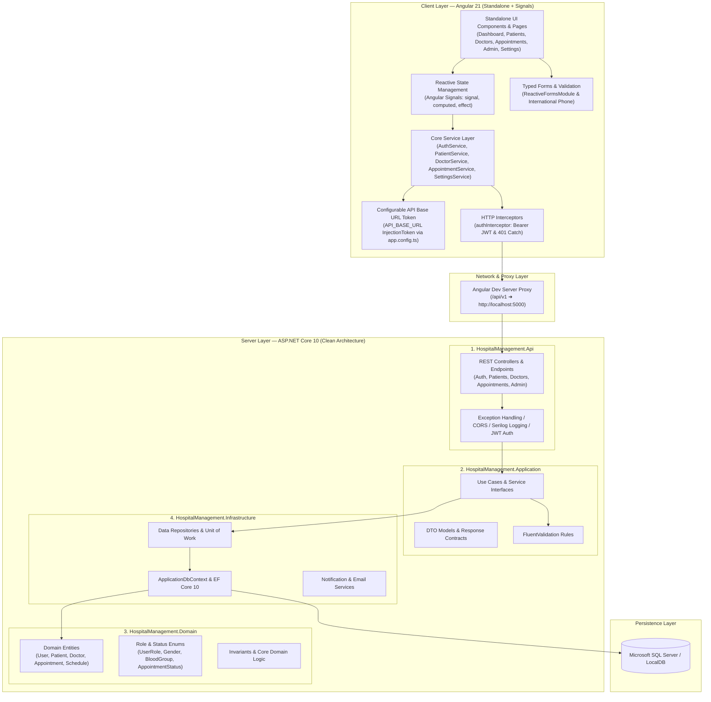

# 🏥 CareFlow Hospital Management System (HMS)

> A modern, enterprise-grade **Hospital Management System** built with **Angular 21** (Standalone Components, Signals, Modern Control Flow, Tailwind CSS v4) and **ASP.NET Core 10** (.NET 10, Entity Framework Core, SQL Server) adhering to **Clean Architecture** and **Feature-Based Frontend Design**.

[](https://angular.dev/)
[](https://dotnet.microsoft.com/)
[](https://www.typescriptlang.org/)
[](https://tailwindcss.com/)
[](https://www.microsoft.com/sql-server/)

---

## 🏛️ Full Architectural Flow



---

## 🌐 Centralized API Base URL Configuration

The frontend provides a **single, centralized configuration point** for the backend API URL. Rather than hardcoding URLs across services, all HTTP requests inject `API_BASE_URL`:

```
┌─────────────────────────────────┐
│ src/environments/environment.ts │ ➜ apiBaseUrl: '/api/v1'
└────────────────┬────────────────┘
                 │
                 ▼
┌─────────────────────────────────┐
│     src/app/app.config.ts       │ ➜ provide: API_BASE_URL, useValue: environment.apiBaseUrl
└────────────────┬────────────────┘
                 │
                 ▼
┌─────────────────────────────────┐
│     Core Angular Services       │ ➜ private readonly baseUrl = inject(API_BASE_URL);
│  (Auth, Patient, Doctor, Appt)  │    this.http.get(`${this.baseUrl}/patients`)
└─────────────────────────────────┘
```

- **Local Development**: In `src/app/app.config.ts`, `API_BASE_URL` uses `environment.apiBaseUrl` (`/api/v1`), which proxies seamlessly to `http://localhost:5000` via `proxy.conf.json`.
- **Production / Staging**: Change `apiBaseUrl` in `src/environments/environment.prod.ts` or directly in `app.config.ts` without touching any service or component code.

---

## 🚀 Key Modules & Capabilities

### 1. 🔐 Authentication & RBAC (Role-Based Access Control)
- **Role Hierarchy**: `Admin (100)`, `HospitalManager (90)`, `Doctor (80)`, `Pharmacist (75)`, `LabTechnician (70)`, `Nurse (60)`, `Receptionist (40)`, `Patient (20)`.
- **Functional Route Guards**:
  - `authGuard`: Verifies valid JWT token and authenticates session.
  - `roleGuard`: Ensures route access matches user role hierarchy and privileges.
- **Onboarding Workflow**: Staff registration submissions, admin authorization/rejection with notes, account status toggle.

### 2. 📊 Hospital Operations Dashboard
- **Role-Adaptive Interface**: Automatically toggles between Patient Healthcare Portal and Staff Hospital Management System.
- **Real-Time Clock**: Live digital clock widget synchronized with regional timezone settings.
- **Operational Metrics**: Real-time patient counts, appointments today, active doctors on duty, department loads.

### 3. 👥 Patient Directory & Health Records
- **Demographic Management**: Full demographics, date of birth past-validation, blood group enums, international phone formatting (E.164).
- **Patient Search & Table**: Real-time search by MRN, name, phone; column sorting; pagination; action menus.
- **Patient Profile View**: Emergency contact details, medical record history, quick appointment booking.

### 4. 🩺 Doctor Directory & Interactive Scheduling
- **Doctor Directory**: Department filtering, specialty search, experience, consultation fees, live availability status badges.
- **Interactive Calendar View**: 7-day strip picker, grouped time slot availability badges (`Available`, `Booked`, `Past`, `Blocked`).
- **Doctor Schedule Manager**: Weekly recurring hours configuration, exceptions and leave management with conflict checks.

### 5. 📅 Appointment Booking & Life-Cycle Management
- **Booking Modal**: Doctor selection, dynamic slot lookup from availability matrix, visit reason, notes.
- **Status Lifecycle Workflow**: `Pending ➜ Confirmed ➜ CheckedIn ➜ InConsultation ➜ Completed` (or `Cancelled` / `NoShow`).

### 6. 🔔 Reactive Notifications & System Alerts
- **Notification Bell Dropdown**: Signal-driven unread badge, popover dropdown with mark-as-read and target routing.
- **Full Notification Center**: Filter by category (`Staff`, `Appointments`, `Clinical`, `System`), priority (`Urgent`, `Normal`, `Low`), and archive management.

### 7. ⚙️ System Settings & Customization
- **Theme Mode**: Instant light, dark, and system theme switching applied reactively to HTML root.
- **Display Density**: Compact vs Comfortable layout modes.
- **Regional & Time**: 12-hour / 24-hour clock formats, regional timezones, date formatting patterns.

---

## 🛠️ Technology Stack

| Layer | Technology | Description |
| :--- | :--- | :--- |
| **Frontend Framework** | **Angular 21** (`@angular/core@^21.2.0`) | Standalone Components, Signal-based reactivity, Modern Control Flow |
| **Frontend Routing** | **Angular Router** | Functional guards (`authGuard`, `roleGuard`), lazy chunk loading |
| **Styling & Theme** | **Tailwind CSS v4** | `@tailwindcss/postcss`, responsive layout, dark mode, compact mode |
| **Icons** | **Lucide Icons** | SVG icon component registry with over 40 medical & UI icons |
| **HTTP Client** | **Angular HttpClient** | Functional interceptors, `API_BASE_URL` InjectionToken |
| **Backend Framework** | **ASP.NET Core 10** | Minimal APIs & REST Controllers with OpenAPI |
| **ORM & Database** | **EF Core 10 + SQL Server** | Code-First migrations, automated MRN generation, relational modeling |
| **Logging** | **Serilog** | Structured console and file event logging |
| **Backend Validation** | **FluentValidation** | Request pipeline validation |

---

## 📁 Repository Structure

```
HospitalManagementSystem_Angular/
├── backend/                                # .NET 10 Solution
│   ├── HospitalManagement.slnx             # Solution file
│   ├── HospitalManagement.Api/             # Web API Controllers, Cors, Program.cs
│   ├── HospitalManagement.Application/     # CQRS/Use Cases, DTOs, FluentValidators
│   ├── HospitalManagement.Domain/          # Domain Entities, Enums, Value Objects
│   ├── HospitalManagement.Infrastructure/  # EF Core DbContext, Repositories, Migrations
│   └── HospitalManagement.Tests/           # xUnit Unit & Integration Tests
│
├── frontend/                               # Angular 21 Application
│   ├── src/
│   │   ├── app/
│   │   │   ├── app.config.ts               # Application providers & API_BASE_URL token
│   │   │   ├── app.routes.ts               # Standalone route definitions with guards
│   │   │   ├── app.component.ts            # Root application shell component
│   │   │   │
│   │   │   ├── core/                       # Core singleton infrastructure
│   │   │   │   ├── guards/                 # authGuard, roleGuard
│   │   │   │   ├── interceptors/           # auth.interceptor (Bearer JWT)
│   │   │   │   ├── models/                 # TypeScript DTOs & Contracts
│   │   │   │   ├── services/               # Signal-based API services
│   │   │   │   ├── tokens/                 # API_BASE_URL InjectionToken
│   │   │   │   └── utils/                  # Date, phone, and formatting utilities
│   │   │   │
│   │   │   ├── layout/                     # Application shell & navigation
│   │   │   │   ├── app-layout.component.ts # Responsive sidebar, header, dark toggle
│   │   │   │   └── notification-bell/      # Header bell popover
│   │   │   │
│   │   │   ├── features/                   # Standalone feature modules
│   │   │   │   ├── admin/                  # Admin dashboard, staff approvals, users
│   │   │   │   ├── appointments/           # Appointment directory & booking modal
│   │   │   │   ├── auth/                   # Login, reset password, contact helpdesk
│   │   │   │   ├── dashboard/              # Role-adaptive analytics & live clock
│   │   │   │   ├── doctors/                # Doctor directory, calendar, schedules
│   │   │   │   ├── notifications/          # Full notification center
│   │   │   │   ├── patients/               # Patient directory & registration form
│   │   │   │   └── settings/               # System preferences & profile settings
│   │   │   │
│   │   │   └── shared/                     # Reusable shared components
│   │   │       ├── icon/                   # Lucide SVG icon registry component
│   │   │       ├── page-header/            # Header with title, subtitle & action slots
│   │   │       ├── status-badge/           # Life-cycle & approval status badges
│   │   │       ├── empty-state/            # Empty table & list visual placeholder
│   │   │       └── phone-input/            # International phone input with dial codes
│   │   │
│   │   ├── environments/                   # environment.ts & environment.prod.ts
│   │   ├── styles.css                      # Tailwind CSS v4 & custom variables
│   │   └── index.html                      # HTML root template
│   │
│   ├── angular.json                        # Angular CLI build & serve configurations
│   ├── proxy.conf.json                     # Dev proxy configuration (/api ➜ localhost:5000)
│   ├── package.json                        # Frontend dependencies & scripts
│   └── tsconfig.json                       # TypeScript compiler options & path aliases
│
├── MIGRATION_CHECKLIST.md                  # Comprehensive React ➜ Angular migration tracker
├── package.json                            # Root scripts for full-stack workflows
└── README.md                               # Project documentation
```

---

## 🚦 Getting Started

### Prerequisites
- [.NET 10 SDK](https://dotnet.microsoft.com/download/dotnet/10.0) (or .NET 9+)
- [Node.js (v20+)](https://nodejs.org/) & `npm`
- [SQL Server](https://www.microsoft.com/sql-server/) (or LocalDB)

### 1. Clone Repository
```powershell
git clone https://github.com/KISHORETAMIL03579/HospitalManagementSystem_Angular.git
cd HospitalManagementSystem_Angular
```

### 2. Backend Setup
```powershell
# Restore and build the .NET solution
dotnet build backend/HospitalManagement.slnx

# Apply EF Core migrations to SQL Server
dotnet ef database update --project backend/HospitalManagement.Infrastructure --startup-project backend/HospitalManagement.Api

# Start ASP.NET Core API (Runs at http://localhost:5000)
npm run start:backend
```

### 3. Frontend Setup
```powershell
# Install frontend dependencies
npm --prefix frontend install

# Start Angular development server (Runs at http://localhost:5173 with proxy)
npm run dev
```

### 4. Run Both Simultaneously
```powershell
# Starts both Angular frontend and ASP.NET Core API concurrently
npm run dev:full
```

---

## 🧪 Available Scripts

Run from repository root:

| Command | Action |
| :--- | :--- |
| `npm run dev` | Starts the Angular 21 development server at `http://localhost:5173` |
| `npm run start:backend` | Starts the ASP.NET Core API server at `http://localhost:5000` |
| `npm run dev:full` | Concurrently launches Angular frontend and .NET backend |
| `npm run build` | Compiles the Angular frontend production bundle into `frontend/dist/` |
| `npm run build:backend` | Builds the .NET solution |
| `npm run build:all` | Compiles both frontend and backend |
| `npm run lint` | Runs Oxlint code analysis on frontend TypeScript |
| `npm run format` | Runs Prettier on frontend and `dotnet format` on backend |
| `npm run test` | Executes backend xUnit test suite |
| `npm run clean` | Cleans backend build artifacts |

---

## 📝 License
This project is licensed under the MIT License.
